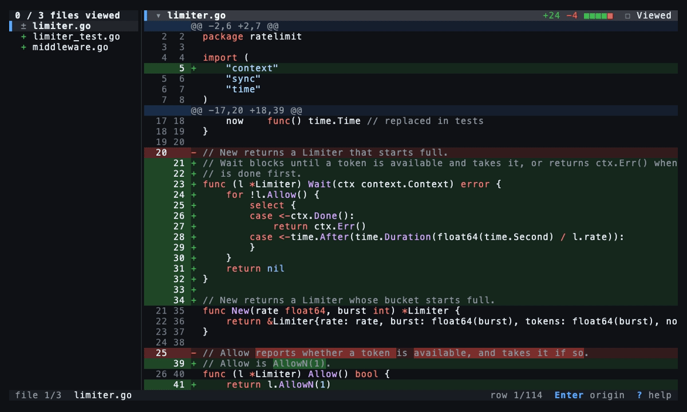

<p align="center">
  <a href="https://github.com/JinmuGo/dr">
    <picture>
      <source media="(prefers-color-scheme: dark)" srcset="docs/logo-dark.svg">
      
    </picture>
  </a>
</p>

<p align="center"><b>Diff review with the AI that wrote it.</b></p>

<p align="center">
  <a href="https://github.com/JinmuGo/dr/actions/workflows/ci.yml"></a>
  <a href="https://pkg.go.dev/github.com/JinmuGo/dr"></a>
  <a href="LICENSE"></a>
</p>

<p align="center">
  <a href="docs/install.md">Install</a> ·
  <a href="docs/usage.md">Usage</a> ·
  <a href="CONTRIBUTING.md">Contributing</a>
</p>

dr shows which AI agent session wrote each changed line and what you asked it. Ask that session why, leave review comments, and get fixes back from it. It works with Claude Code, Codex and OMP.



## Why dr

- **See who wrote each line.** `git blame` names you, because you committed. dr names the agent session and the request behind the line.
- **Ask the author.** `a` asks the session that wrote a line why. dr asks a fork, so your conversation stays as it was.
- **Get fixes from the author.** Comment as in a pull request review. Each session fixes only the lines it wrote.
- **Three agents, one diff.** Claude Code, Codex and OMP sessions side by side, each in its own color.
- **Local.** Origins come from the session logs on your machine, with no model calls. No server, no account, no telemetry.

## Install

```sh
brew install jinmugo/tap/dr                         # Homebrew
curl -fsSL https://dr.jinmugo.com/install.sh | sh   # script
nix profile install github:JinmuGo/dr               # Nix
go install github.com/JinmuGo/dr@latest             # Go
```

dr runs on macOS and Linux and needs git. Asking and fixing also need the CLI of the agent that wrote the lines: `claude`, `codex` or `omp`. Versions, upgrades and removal are in [docs/install.md](docs/install.md).

## Usage

```sh
cd your-repo   # after an agent has finished its work
dr
```

Move with `j` and `k`. `Enter` shows where a line came from, `a` asks its session, `c` leaves a comment and `:submit` sends your comments. `?` lists every key. More in [docs/usage.md](docs/usage.md).

In OMP and Pi, the dr plugin ([OMP](docs/usage.md#opening-from-omp), [Pi](docs/usage.md#opening-from-pi)) adds `/dr`. Review in the same terminal and press `q` to return to your conversation.

## License

[MIT](LICENSE)
